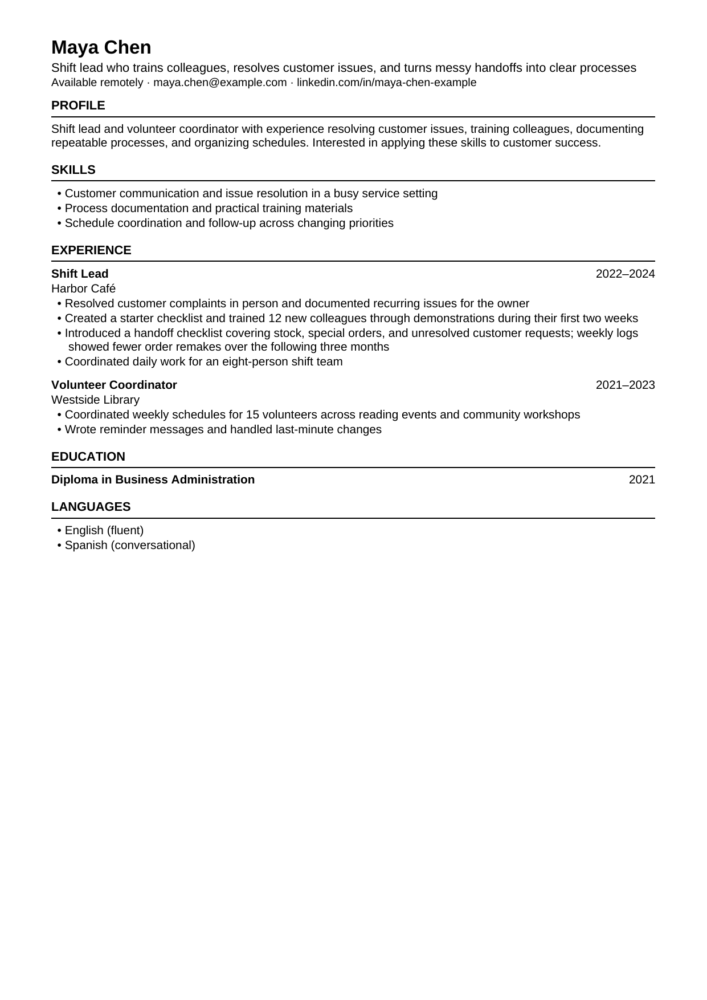

# CV Agent Kit

**Your experience is bigger than the CV or resume you last sent.**

Two complementary [Agent Skills](https://agentskills.io/specification) that help you build a thorough master career record, then tailor a truthful CV or resume for a specific job — including a clean one-page PDF when your environment can render it.

## Quick start

Install [Node.js 22.20 or later](https://github.com/vercel-labs/skills#install-a-skill), then run:

```bash
npx skills add Jorge-AI700/cv-agent-kit -g
```

The installer prompts you to select the skills and agent; choose both skills and your agent. `-g` makes them available across your projects. Then ask:

1. “Build my master CV. Start by asking about my existing CV or career timeline.”
2. “Create a CV for this job from my master CV.” Paste or attach the posting, and your saved master CV if the chat does not already have it.



The preview above is the fictional example CV in `examples/`, rendered by `skills/job-cv-builder/scripts/render_cv.py`. Maya is early in her career, so the page is not completely filled; that is expected for this example.

A CV or resume is a selection of your experience, made for a particular moment and role. It leaves out projects, decisions, and results that may matter for the next opportunity. When you change direction, those missing details make transferable skills especially hard to show. You may have led people, improved a process, or solved customer problems without ever having held the title in a new job posting.

One fixed document cannot give every part of that experience the space it deserves. Rewriting it for each application often means trying to recover useful examples from memory.

CV Agent Kit works in two stages:

1. **Build a master CV.** The agent interviews you about your work, including details beyond an existing CV, and saves a thorough Markdown record in your own words. It records evidence, context, and uncertainties.
2. **Build a CV for a job.** Give the agent a job posting. It identifies what the employer explicitly requires and prefers, finds relevant evidence in your master CV, asks about important gaps, and drafts a focused CV.

Each job-specific CV emphasizes a different, evidence-backed part of the same history.

## Transferable skills need a story

“Leadership” or “process improvement” alone tells an employer little. A concrete example shows what you did and what changed. Consider this fictional master CV note:

> Trained 12 new starters and introduced a shift handoff checklist; weekly logs suggest order remakes fell by about 20% over three months.

- **Operations lens:** Introduced a shift handoff checklist; weekly logs showed fewer order remakes afterward.
- **Training lens:** Created starter guidance and trained 12 new colleagues.

Both versions draw from the same work. The estimated percentage should be confirmed before it becomes an exact claim in either CV.

That is why the master CV keeps more detail than a conventional CV: it preserves the evidence needed to recognize and explain transferable skills later.

## What you receive

| Step | Output |
| --- | --- |
| Career interview | A detailed `master-cv.md` that you can keep and update. |
| Job application | A tailored `cv.md` and `application-notes.md` showing the job requirements, supporting evidence, and unanswered questions. When rendering tools are available, also a `Firstname-Lastname-CV-Company.pdf`. |

The master CV is yours. Keep it somewhere private and bring it to a later conversation when you want to apply for a job. This repository contains only the instructions and fictional examples; it does not store your career information.

## Use it in any chat

You can use the toolkit in a chat that accepts text, even when it cannot install skills or write files:

1. Copy or attach [the master CV instructions](skills/master-cv-builder/SKILL.md). Ask: “Follow these instructions to build my master CV. Start by asking about my existing CV or career timeline.” Save the complete Markdown record the agent returns.
2. For an application, copy or attach [the job CV instructions](skills/job-cv-builder/SKILL.md), provide your saved master CV, and paste the job description or its URL. Ask: “Use these instructions to create a CV for this job from my master CV.”

If the chat cannot open the URL, paste the job description. If it cannot save files, ask it to return the complete Markdown for you to save. A chat may not retain your master CV between sessions, so provide it again when needed.

## Install in a compatible agent

The two folders under `skills/` follow the [Agent Skills format](https://agentskills.io/specification). On macOS, Windows, or Linux, install [Node.js 22.20 or later](https://github.com/vercel-labs/skills#install-a-skill), then run the Quick start command above.

The installer prompts you to select the skills and agent; choose both skills and your agent. `-g` makes them available across your projects. From a local checkout, run `npx skills add . -g`. See the [installer documentation](https://github.com/vercel-labs/skills/blob/main/docs/commands.md) for noninteractive options and supported agents. If you do not want to use Node.js or a terminal, use the chat instructions above or copy the skill folders into your agent's skills directory.

After installation, you can ask your agent to build your master CV or tailor a CV or resume to a job posting. The skills also work when you invoke them explicitly by name.

## Render a PDF

The job skill includes a small Python renderer, `skills/job-cv-builder/scripts/render_cv.py`, that turns tailored Markdown into DOCX and PDF:

- `pip install python-docx`
- LibreOffice (`soffice`) for PDF export
- `poppler-utils` (`pdfinfo`, `pdftoppm`) for page-count and preview checks

If those tools are not available, Markdown remains the portable default. When `python-docx` is installed but LibreOffice is missing, the script writes the DOCX and says that no PDF was created.

```bash
python skills/job-cv-builder/scripts/render_cv.py examples/fictional-tailored-cv.md --check
```

Use `--page-size letter` for US Letter. Use `--font-size` to adjust the body size during visual checks (about 9.5 to 10.5pt).

## Principles

- **Evidence before keywords.** The job posting guides selection; it never becomes evidence about you.
- **Truthful tailoring.** The agent must not invent titles, dates, qualifications, metrics, or industry experience.
- **Visible gaps.** Missing evidence and uncertain claims belong in the application notes, where you can resolve them.
- **User-owned records.** You choose where to keep your master CV and application files. Your chat or agent provider's data handling rules still apply to anything you share with it.

Follow a fictional handoff from the [master CV](examples/fictional-master-cv.md) and [job posting](examples/fictional-job.md) to a [tailored CV](examples/fictional-tailored-cv.md) and [application notes](examples/fictional-application-notes.md). The candidate has transferable training and customer communication experience, while direct B2B software experience and CRM use remain gaps.

## Contributing

Issues and pull requests are welcome. Please keep examples fictional — do not add real personal data — and preserve the kit's evidence-only approach to tailoring.

## License

MIT. See [LICENSE](LICENSE).
